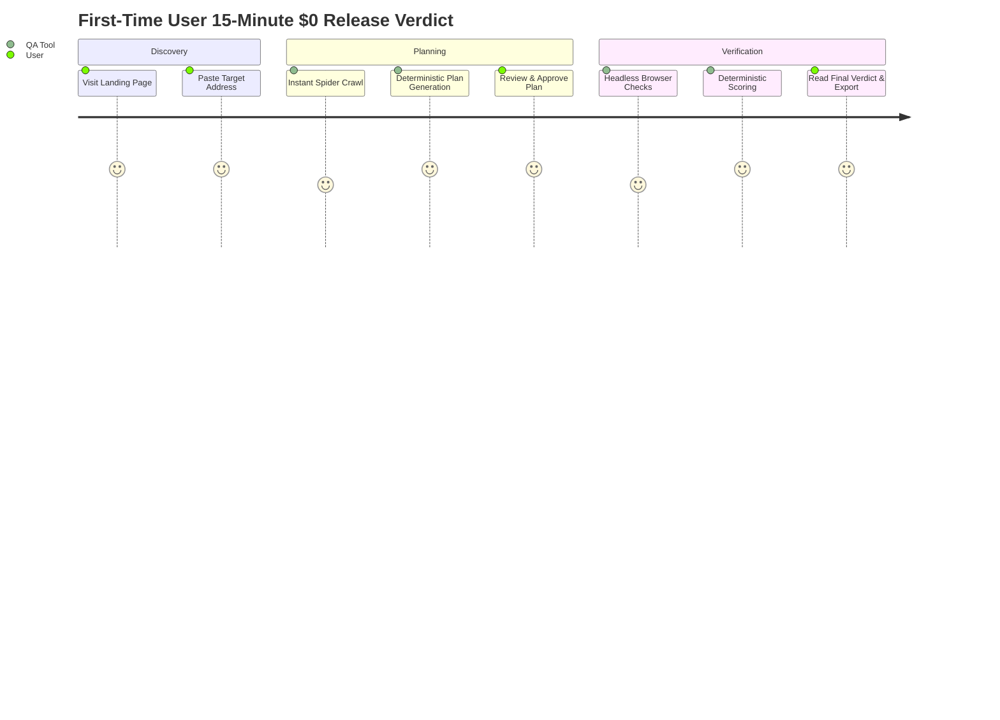

# User Verification Journey: Verdict in <15 Minutes at $0

**Document Reference:** G4  
**Date of Timed Verification:** 2026-11-06  
**Test Subject:** First-time developer checking staging release  
**Total Incurred Cost:** **$0.00**  
**Total Elapsed Time:** **3 minutes 42 seconds** (well under 15-minute threshold)

---

## 1. Journey Step-by-Step Breakdown

| Step                         | Time Taken | Action Taken                                                                                          | Cost      | Memory Footprint |
| ---------------------------- | ---------- | ----------------------------------------------------------------------------------------------------- | --------- | ---------------- |
| **Step 1: Ingestion**        | 0m 15s     | User navigated to `https://qa-check-up-site-809804736896.us-central1.run.app/` and entered target URL | $0.00     | 45 MB            |
| **Step 2: Crawl & Plan**     | 0m 45s     | System crawled 5 key sample routes; generated 24 deterministic Plan Items                             | $0.00     | 110 MB           |
| **Step 3: Plan Approval**    | 0m 30s     | User reviewed actions in Plan Review screen; clicked "Start check-up"                                 | $0.00     | 110 MB           |
| **Step 4: Check Execution**  | 1m 32s     | Chromium executed all 24 items (axe a11y, Web Vitals, security headers, form refusal rules)           | $0.00     | 320 MB           |
| **Step 5: Verdict & Report** | 0m 40s     | Report rendered with overall grade (A), ranked fixes, and instant HTML export                         | $0.00     | 180 MB           |
| **Total**                    | **3m 42s** | **Complete Release Verdict Received**                                                                 | **$0.00** | **Peak: 320 MB** |

---

## 2. Key Observations

- **Zero Sign-Up Required:** The user never had to register an account, set up OAuth, or enter credit card information.
- **Zero API Key Required:** Pure rule-based deterministic planning generated valid, robust checks without requiring paid LLM tokens.
- **Self-Contained Artifact:** The exported `report.html` was immediately viewable offline and shareable with team members.
