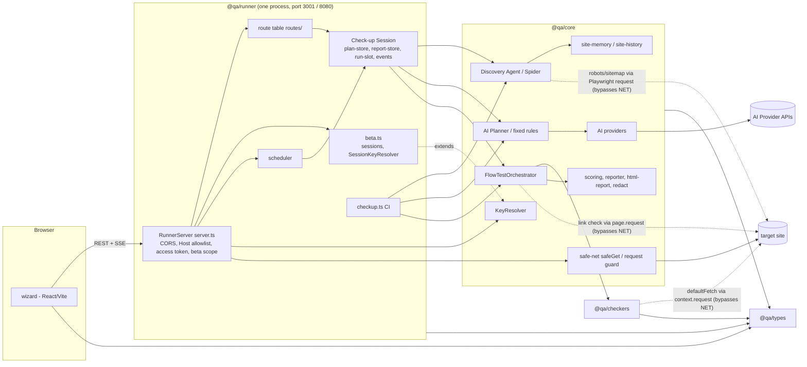

# Architecture

> Maintained by AI-EOS (architecture-analyst). Describes the system **as built**, then recommendations.
> Recommendations that change architecture are proposals until approved and recorded in `decisions.md`.
> Source: ARCHAN-004, commit 71cf6af plus the uncommitted working tree on `feat/website-audit` (2026-11-03).
> Every claim cites `path:line`. Unknowns are stated as unknowns. Paths are relative to the repository root.

## Context

QA Flow Tester ("Release check-up") is a self-hosted tool that crawls a web App, writes a reviewable Plan,
runs it with Playwright plus deterministic checkers, and produces a pre-release report with one verdict
(`docs/ARCHITECTURE.md:20-36`, ADR 0029). A second entry point, the **Website Audit** (ADR 0033), a read-only
audit of someone else's public site, is accepted and is being built on this branch. Today only its **contract**
exists (`packages/types/src/website-audit.ts:1035-1081`); no runner route, core pipeline or wizard screen
implements it yet (no file outside `packages/types` references `WebsiteAudit`/`AUDIT_API`).

Users and deployments:
- **Local:** one person on their own machine, `pnpm start`, http://localhost:3001 (`packages/runner/src/cli.ts`).
- **CI:** `packages/runner/src/checkup.ts` runs one Check-up in-process with no HTTP server.
- **Hosted beta (Cloud Run):** `RUNNER_BETA=1`, `--max-instances 1`, `--min-instances 0`, data in `/tmp`, behind
  `RUNNER_ACCESS_TOKEN` (`.github/workflows/deploy.yml:125-131`). A static site is deployed separately
  (`site/Dockerfile`, `.github/workflows/deploy.yml:155-186`).

External systems: target web Apps/sites (via Playwright Chromium and Node HTTP), AI Providers (Anthropic,
OpenAI, Gemini, OpenRouter; `packages/core/src/ai/providers/*.ts`, `packages/core/src/ai/openrouter.ts`),
OS keychain via `@napi-rs/keyring` (`packages/core/src/ai/key-resolver.ts:65-82`), Google Secret Manager for the
access token (deploy only). Planned: Google PageSpeed Insights (`SERVICE_KEY_NAMES`, `key-resolver.ts:14`).

## Components and module boundaries

Derived from `package.json` dependencies and imports, not folder names. Dependency direction is clean:
no `@qa/core`/`@qa/runner` import in `packages/checkers/src`, no `@qa/runner` import in `packages/core/src`, and no
Node built-in import in `packages/types/src` (grep, this analysis).

| Component | Responsibility | Owns data | Interfaces | Evidence |
|---|---|---|---|---|
| `@qa/types` | Shared types and pure logic: plan types, `releaseVerdict`, problem grouping, Check-up API shapes, Website Audit contract and validators | None (pure) | `index.ts` barrel (Node consumers); `browser.ts` browser-safe subset (wizard) | `packages/types/package.json`; `packages/types/src/browser.ts:1-19`; `packages/types/src/checkup-api.ts:24-193` |
| `@qa/checkers` | Deterministic per-page audits (bug detection, security, security-depth, keyboard a11y, SEO/AEO/GEO, performance, design, UX, marketing, permission matrix, spec conformance, site root, refusal rule) | None | Checker classes taking a Playwright `Page`; optional `FetchFn` injection | `packages/checkers/package.json` (deps: types, playwright, axe); `packages/checkers/src/security-depth.ts:30-50`; `packages/checkers/src/site-root.ts:43` |
| `@qa/core`: discovery | Deterministic Spider, Discovery Agent, safety filter, docs fetch, docx conversion | Crawl drafts in output dir | `DiscoveryAgent.discoverWithSession`, `restoreSession` | `packages/core/src/discovery/deterministic-spider.ts`; `packages/core/src/discovery/discovery-agent.ts:383,482,905` |
| `@qa/core`: planning | AI Planner, fixed-rule fallback, expansion, spec plan, pipelined planning | None (returns Plan) | `plan/*.ts` | `docs/ARCHITECTURE.md:24-27` |
| `@qa/core`: execution | `FlowTestOrchestrator` runs a Plan; calls checkers; retries; evidence | `runs/<id>/evidence`, `auth/` | `FlowTestOrchestrator` class | `packages/core/src/orchestrator.ts:343-365` |
| `@qa/core`: judgement and reports | Scoring, recommendations, reporter, HTML report, redaction | `report.md`, `findings.json`, `report.html`, `issues.*` | `Reporter`, `html-report.ts` | `packages/core/src/reporter.ts:51-71`; `packages/core/src/html-report.ts:37`; `packages/core/src/redact.ts` |
| `@qa/core`: memory | Per-site memory and history | `<data>/sites/*.json`, `<data>/<host>.history.json` | `site-memory.ts`, `site-history.ts` | `packages/core/src/site-memory.ts:115-180`; `packages/core/src/site-history.ts:26` |
| `@qa/core`: network safety | Pinned-resolver GET (`safeGet`), browser request guard, Verified Domain proof, address classification | None | `safeGet`, `makeRequestGuard`, `verifyDomainProof` | `packages/core/src/safe-net.ts:115-242` |
| `@qa/core`: AI and keys | Provider adapters, OpenRouter client, `KeyResolver` (keychain, then encrypted file, then env) | `<data>/.qa-keys.json` (encrypted), `<config>/qa-flow-tester/key-file.key` | `KeyResolver`, `SecretStore`, `createAIProvider` | `packages/core/src/ai/key-resolver.ts:84-340` |
| `@qa/runner`: transport | HTTP + SSE server, CORS, Host allowlist, access-token gate, beta scoping, static UI | `<data>/.qa-ai-models.json`, `.qa-ai-model-record.json`, `.qa-settings.json`, `spec-overrides.json`, `benchmark-shots/` | REST under `/api/*`, SSE `/api/runner/stream`, `/healthz` | `packages/runner/src/server.ts:831-1220`, `:679-681`, `:3423`, `:3550` |
| `@qa/runner`: route table | Declarative routes (Plan routes only so far) | None | `Route`, `matchRoute`, `allRoutes` | `packages/runner/src/routes/route.ts:1-68`; `packages/runner/src/routes/index.ts:9`; `packages/runner/src/routes/plan.ts:1286-1361` |
| `@qa/runner`: Check-up Session | Owns Plan store, report store, single run slot, run secrets, event log | `<data>/.qa-plan.json`, `<data>/waiting-plans/`, `<out>/runs/<id>/` | `CheckupSession`, `createCheckupRun` | `packages/runner/src/session/checkup-session.ts:16-80`; `packages/runner/src/session/plan-store.ts:149,204` |
| `@qa/runner`: beta | Per-visitor session (cookie), in-memory secrets, rate limits, private-target refusal | In-memory only | `sessionFor`, `SessionKeyResolver`, `claimBetaRun`, `refusedTarget` | `packages/runner/src/beta.ts:20-303` |
| `@qa/runner`: scheduler | Scheduled read-only Check-ups (local only) | `<data>/schedules.json` | `SchedulerManager` | `packages/runner/src/scheduler.ts:24`; `packages/runner/src/server.ts:839,1226-1254` |
| `@qa/runner`: CI entry | Headless Check-up for CI | `qa-report/` | `checkup.ts` | `packages/runner/src/checkup.ts` |
| `@qa/wizard` | React UI; runner client | None (browser state) | `src/api.ts` | `packages/wizard/package.json` (only workspace dep is `@qa/types`); `packages/wizard/src/api.ts:1-14` |

## Service relationships

No import cycles between packages. Layer notes:
- `RouteContext` still hands every route the whole `RunnerServer` (`packages/runner/src/routes/route.ts:6`, comment
  "T-207 replaces this with the session"). Only Plan routes moved into the table (`routes/index.ts:9`); about 40
  other endpoints are inline `if (pathname === ...)` branches in `server.ts:925-1201`. ADR 0027 is partly done.
- The benchmark busy flag lives on the server (`server.ts:481`), not in the session's `RunSlot`
  (`session/run-slot.ts:3-22`). "One run at a time" is enforced in two places (`server.ts:1227,1284`).

## API contracts

Error model in practice: JSON `{ error, code?, suggestion? }` with codes such as `ERR_BETA`, `ERR_BETA_LIMIT`,
`ERR_PRIVATE_TARGET` (`server.ts:911,915-918,1354-1359`); 404 `{ error: 'Not found' }` (`server.ts:1206-1207`);
500 with a redacted message (`server.ts:1208-1211`). Some paths answer `text/plain` (`server.ts:1154-1155,1197-1198`).
No path versioning (`/api/...`, not `/api/v1/...`). Body size cap is 5,000,000 characters
(`packages/runner/src/routes/body.ts:4-12`). Request bodies are checked by hand-written validators
(`packages/runner/src/run-inputs.ts:35-365`), not a schema library.

| Contract | Producer | Consumers | Format / schema | Versioning | Evidence |
|---|---|---|---|---|---|
| `POST /api/runner/run` (start Check-up) | runner | wizard, scheduler (in-process) | `RunStartBody` / `RunStartReply` | none | `server.ts:961-964,2779`; `packages/types/src/checkup-api.ts:24,135` |
| `GET /api/runner/status` | runner | wizard | `RunnerStatusReply` (beta: masked when not the caller's run) | none | `server.ts:985-1005,1282-1299`; `checkup-api.ts:176` |
| `GET /api/runner/stream` (SSE) | runner | wizard | `data: <OrchestratorEvent JSON>`; replays current run's log with `replayed: true` | none | `server.ts:939-958` |
| Plan routes `/api/runner/plan*`, `/api/runner/waiting-plans` | runner (route table) | wizard | `PlanPatchBody`, `ApprovalReply` | none | `routes/plan.ts:1286-1361`; `checkup-api.ts:143,193` |
| `/api/runs/*` (past Check-ups, triage, delete) | runner | wizard | JSON, files | none | `server.ts:931-936,1345` |
| `/api/report`, `/api/report/download/*`, `/api/evidence/*` | runner | wizard, report HTML | JSON / files; path traversal and saved-session checks | none | `server.ts:973-983,1058-1062,1151-1201` |
| `/api/ai/*`, `/api/ai/openrouter/*` | runner | wizard (settings) | JSON | none | `server.ts:1064-1076` |
| `/api/sites/*`, `/api/settings/defaults`, `/api/runner/schedules*`, baselines, benchmark, spec-override, preflight, ai-estimate, context/docx, domain-proof | runner | wizard | JSON | none | `server.ts:1018-1148` |
| `/healthz` | runner | Cloud Run / ops | `200 ok` text, before auth | n/a | `server.ts:847-851` |
| **Website Audit API** (`AUDIT_API`, 40 routes incl. public `/s/:linkId`, helper sign-in) | **not implemented** | wizard (planned) | Typed by `AuditApiShapes`; start validated by shared `validateAuditStartBody`; per-route `access` level (`owner`, `view`, `edit`, `export`, `public`, `sign-in`) | none | `packages/types/src/website-audit.ts:178,1026-1081,1326-1330` |
| Checker `FetchFn` | core (intended) | `SecurityDepthChecker`, `site-root` | `(url) => Promise<FetchedResponse \| null>` | n/a | `packages/checkers/src/security-depth.ts:30`; `packages/checkers/src/site-root.ts:43` |
| Report files | core reporter | people, CI, AGENTS snippet | `findings.json` (Findings contract, ADR 0017), `report.md`, `report.html` | `schemaVersion?` on report | `packages/core/src/reporter.ts:51-71`; `packages/types/src/run-report.ts:102` |

## Data model

All state is JSON files on the local file system or process memory. There is no database.

| Store | Owner | Location | Versioning / write safety | Evidence |
|---|---|---|---|---|
| Plan under review, waiting Plans | Check-up Session `PlanStore` | `<data>/.qa-plan.json`, `<data>/waiting-plans/<host>.json` | `schemaVersion: 1` | `runner/src/session/plan-store.ts:20,149,204,297` |
| Run reports, evidence, thumbnails | `ReportStore`, orchestrator, reporter | `<out>/runs/<runId>/...` | report `schemaVersion?` | `runner/src/session/report-store.ts:68,82`; `core/src/orchestrator.ts:364` |
| Site memory | core `site-memory` | `<data>/sites/<host>.json` (beta: `<data>/sessions/<sid>/...`) | `schemaVersion: 1`; refuses to overwrite newer | `core/src/site-memory.ts:115-180`; `runner/src/server.ts:742-745` |
| Site history | core `site-history` | `<data>/<host>.history.json` | unknown | `core/src/site-history.ts:26` |
| Schedules | runner scheduler | `<data>/schedules.json` | unknown | `runner/src/scheduler.ts:24` |
| AI model choices, settings, spec overrides | runner server | `<data>/.qa-ai-models.json`, `.qa-settings.json`, `spec-overrides.json` | unknown | `runner/src/server.ts:679-681,3550` |
| Saved AI / service keys | `KeyResolver` | OS keychain, else `<data>/.qa-keys.json` (AES-256-GCM envelope) | `format`/`version: 1` in AAD | `core/src/ai/key-resolver.ts:43-59,273-317` |
| Local file key | `KeyResolver` | `$XDG_CONFIG_HOME` / `%APPDATA%` / `~/.config` `/qa-flow-tester/key-file.key` | 0600, created with `wx` | `core/src/ai/key-resolver.ts:320-348` |
| Beta sessions, secrets, usage counts, run owners | `beta.ts`, server | process memory | lost on restart by design | `runner/src/beta.ts:20-32,157`; `server.ts:725` |
| Visual baselines | runner | `.qa-baselines/` (committed) | n/a | `docs/ARCHITECTURE.md:47` |

Write safety: a shared `writeJsonAtomic` (temp file + rename) exists (`core/src/atomic-write.ts:16-26`) but is used at
7 call sites, against 38 direct `fs.writeFile` calls in `core/src` and `runner/src` (grep count). Concurrency is
single-process; the key file serialises its own writes (`key-resolver.ts:255-271`). No migrations framework:
version fields are checked ad hoc per store. Multi-tenancy exists only in beta, by session id in memory and a
per-session site folder (`server.ts:742-745`).

Website Audit (planned) adds a new store of third-party data (page text, screenshots, owner contact details,
shortlist outcomes; ADR 0033 Consequences). Its location and retention are not yet in code.

## Cross-cutting concerns

| Concern | Current approach | Evidence | Gap |
|---|---|---|---|
| Authentication | Optional shared access token (cookie, `X-QA-Access` header, or `?access=` moved to an HttpOnly cookie), constant-time compare. Beta adds an anonymous per-visitor session cookie. | `server.ts:268-272,794-829`; `beta.ts:103-121` | One shared secret, no per-user identity. The Website Audit contract needs `owner`/`edit`/`view`/`export`/`public`/helper sign-in levels (`website-audit.ts:1037-1080`) that the server has no model for. |
| Authorization | Beta: run ownership by session (`isMine`), closed routes, masked status. Local: everyone is the owner. | `server.ts:735-739,1280-1347` | Rules are imperative path checks in `server.ts`, separate from the route table; a new route is open by default unless added to `closedInBeta`/`betaScope`. |
| Host / origin / CSRF | Host allowlist (loopback, allowed origins, `*.run.app` when `K_SERVICE` set); exact-origin CORS; non-GET cross-origin refused. | `server.ts:853-900` | `*.run.app` accepts any Cloud Run host name (`server.ts:866`); low risk because Google's front end routes by host. |
| Outbound-request safety (ADR 0031) | `safeGet` pins DNS per hop, re-checks redirects, caps bodies; used by docs fetch, domain proof, and one runner path. Browser guard in beta. | `core/src/safe-net.ts:115-189`; `core/src/discovery/docs-fetch.ts:38`; `server.ts:833,1462` | **ADR 0031 is not implemented as written.** `makeOutboundFetch` and `outbound-source-grep.test.ts` do not exist (only in the ADR, commit dcba888). Page-derived requests still use Playwright's request client, which bypasses the browser guard: Spider robots/sitemap (`deterministic-spider.ts:410,429`, `Sitemap:` lines pushed with no host check at `:416-418`), orchestrator link check with 10 redirects (`orchestrator.ts:212`), SEO broken links HEAD then GET (`checkers/src/seo.ts:556-557`), security-depth `defaultFetch` used because the orchestrator passes no `fetchFn` (`checkers/src/security-depth.ts:43-50,146,202`; `orchestrator.ts:1113-1122`), access-control fetcher (`core/src/access-control.ts:178`). Node `fetch` without pinning: `RobotsPolicy.fetch` (`competitive/robots.ts:50`), `localDocsGet` (`docs-fetch.ts:67`), preflight (`preflight.ts:163`). |
| Secrets / keys (ADR 0034) | Keychain first; else AES-256-GCM file with header bound as AAD, random 96-bit IV, 128-bit tag enforced, atomic write, queued saves; key in config folder or derived via scrypt from `QA_KEYS_ENCRYPTION_KEY` (min 16 chars); legacy plaintext migrated on read; never falls back to plaintext. Service keys (`pagespeed`) on the same path. Sign-in passwords keychain-only. | `core/src/ai/key-resolver.ts:204-372` | Implementation matches ADR 0034. Gaps: `SessionKeyResolver` does not override `saveServiceKey`/`resolveServiceKey` (`runner/src/beta.ts:239-266`), so in beta a service key resolves from the owner's file/env (`key-resolver.ts:119-127`) and a save outside a session context writes the encrypted file under `process.cwd()` (`beta.ts:243`, `key-resolver.ts:208-215`). ADR 0034 requires this before any beta route saves one. Docs still say plaintext: `docs/ARCHITECTURE.md:48`, `SECURITY.md:28`, `docs/CONFIGURATION.md:69-71`. |
| Validation | Hand-written per-field validators with caps (documents, sessions, roles, headers); shared `validateAuditStartBody` for the audit. | `runner/src/run-inputs.ts:13-365`; `types/src/website-audit.ts:178-235` | No single schema layer; each new route repeats the pattern. |
| Error handling | Top-level try/catch returns 500 with `redactedMessage`. | `server.ts:1208-1212,650` | Mixed JSON and text error bodies. AI provider errors embed the provider response body (`core/src/ai/providers/anthropic.ts:69-71`). |
| Logging / audit | `console.*` (55 calls in core/runner src) and opt-in `QA_DEBUG` areas with URL and key redaction. | `core/src/debug-log.ts:1-25` | No structured logs, request ids or audit trail of who started or deleted what; acceptable for local use, thin for the hosted beta. |
| Configuration | Environment variables (`RUNNER_*`, `QA_*`, provider keys), deploy flags in workflow. | `server.ts:670-704`; `deploy.yml:130-131` | Read ad hoc across modules; `docs/CONFIGURATION.md` is the only index. |
| Timeouts | Spider/link/robots/docs calls have timeouts; OpenRouter uses `AbortSignal.timeout`. | `core/src/ai/openrouter.ts:78-190` | Anthropic, OpenAI and Gemini provider calls have no timeout or abort signal (`anthropic.ts:59-67`; `openai.ts:62`; `gemini.ts:36,126,142`). A stalled provider can hold the single run slot. |
| Observability | `/healthz`, SSE progress stream. | `server.ts:847-851,939-958` | No metrics. Cloud Run cannot reach `/healthz` (`deploy.yml` comment after line 131), so the deploy check uses the 401 on `/`. |

## Scalability and performance

- **Single process, single run slot.** One Check-up (or benchmark) at a time per runner (`session/run-slot.ts:12`;
  `server.ts:1227`). The Website Audit is to share that slot (ADR 0033 Consequences), so audits and Check-ups
  will queue behind each other; the benchmark flag is outside `RunSlot`, so the audit would be a third flag
  unless the slot is unified.
- **In-memory state** (beta sessions, run owners, SSE clients, event log) pins the hosted runner to
  `--max-instances 1` (`deploy.yml:128`). With `--min-instances 0`, scale-to-zero discards `/tmp` data and all beta
  sessions; on Cloud Run `/tmp` is memory-backed and counts against the 2 GiB limit (`deploy.yml:127`), alongside
  Chromium.
- **Hot spots.** `server.ts` is 3,609 lines and `orchestrator.ts` 1,661 lines; most features land in these two
  files. Evidence files are read fully into memory before sending (`server.ts:1188`). `.docx` conversion runs
  in-process on the request path with caps and a timeout (`core/src/discovery/docx-to-markdown.ts:281`).
- **Bounded work.** Crawl pages are capped (200 UI, `QA_MAX_PAGES` CI default 50; `docs/ARCHITECTURE.md:22`); sitemap
  seeding caps at 200 locs and 25 sitemaps (`deterministic-spider.ts:428,441`); body cap 5 MB.
- **Website Audit throughput.** One request at a time per host with Crawl-delay (ADR 0033, DEC-003) makes large
  audits slow by design.

## Architectural risks

| ID | Risk | Likelihood | Impact | Mitigation |
|---|---|---|---|---|
| AR-01 | Page-derived requests bypass `safeGet` (ADR 0031 unimplemented). On the hosted beta, a target's `robots.txt` `Sitemap:` line or a link that redirects can make the runner request internal addresses (blind SSRF; status codes leak into findings). Evidence: `deterministic-spider.ts:410-429`, `orchestrator.ts:212`, `checkers/src/seo.ts:556`, `checkers/src/security-depth.ts:146,202`, `core/src/access-control.ts:178`. | High (any public site can set these) | High (hosted runner on GCP; Website Audit targets arbitrary third-party sites) | REC-01, REC-02 |
| AR-02 | ADR 0033 says `safeGet` wiring must be built before any Website Audit work (DEC-002), but the audit contract is already in place and the prerequisite is not. Audit code could be written on the unsafe paths. | Medium | High | REC-01 before any audit runner/core task. |
| AR-03 | Beta key isolation gap for service keys: `SessionKeyResolver` inherits `resolveServiceKey`/`saveServiceKey`, so visitors would use the owner's `PAGESPEED_API_KEY` or file key, and an out-of-session save writes to disk (`beta.ts:239-266`; `key-resolver.ts:119-127,204-216`). Latent: no route calls them yet. | Medium (first PageSpeed route) | Medium (owner quota spent by visitors; contradicts "never on disk" in beta) | REC-03 |
| AR-04 | Docs contradict code on key storage (plaintext vs encrypted): `docs/ARCHITECTURE.md:48`, `SECURITY.md:28`, `docs/CONFIGURATION.md:69-71`. ADR 0034 requires the update. | High | Low (misleads operators about Docker volumes and `QA_KEYS_ENCRYPTION_KEY`) | REC-04 |
| AR-05 | No timeout on Anthropic/OpenAI/Gemini calls (`anthropic.ts:59`; `openai.ts:62`; `gemini.ts:126`). A hung provider holds the single run slot indefinitely. | Medium | Medium | REC-05 |
| AR-06 | Authorization lives in imperative path checks (`closedInBeta`, `betaScope`, `server.ts:1280-1347`), separate from routes. The audit adds about 40 routes with six access levels including public Shared Links; a route forgotten in those lists is open to all beta visitors. | Medium | High (cross-visitor data exposure, public publishing) | REC-06 (P2) |
| AR-07 | `server.ts` (3,609 lines) concentrates transport, policy, AI settings, baselines, benchmark and schedules; ADR 0027 migration is partial (`routes/route.ts:6`). Adding the audit inline would grow it further and make drift with the Check-up likely (ADR 0033 notes checker-setup drift). | High | Medium | REC-06, REC-07 |
| AR-08 | Run-exclusion is split between `RunSlot` and `benchmarkBusy` (`server.ts:481,1227`); a third (audit) flag invites a race where two runs start. | Medium | Medium | REC-07 (P2) |
| AR-09 | Hosted data is in memory-backed `/tmp` on a scale-to-zero single instance (`deploy.yml:127-130`). Planned audit storage (third-party personal data, Shared Links) has no durable or access-controlled home; ADR 0036 is referenced but not written. | High (for audit storage) | Medium | REC-08 (P2) |
| AR-10 | Wizard value-imports from the `@qa/types` barrel (`packages/wizard/src/screens/ReportScreen.tsx:2`, `SettingsScreen.tsx:28`), which the browser-entry guard does not walk (`packages/types/tests/browser-entry.test.ts:7-10,153-158`). A Node built-in added to any barrel module would break the wizard bundle or the static site. | Low | Medium | REC-09 |
| AR-11 | Most JSON stores are written with plain `fs.writeFile` (38 sites vs 7 atomic); a crash mid-write can corrupt schedules, settings or history. | Low | Medium | REC-10 |

## Recommendations

| ID | Recommendation | Rationale | Requires approval (P2) | Status |
|---|---|---|---|---|
| REC-01 | Implement ADR 0031 as written: add `makeOutboundFetch` in `core/src/safe-net.ts` on top of `safeGet`; move Spider robots/sitemap (`deterministic-spider.ts:410-429`, with the on-site host check for `Sitemap:` lines), orchestrator `checkLink` (`orchestrator.ts:212`), SEO broken links (`checkers/src/seo.ts:556`) and access-control (`access-control.ts:178`) to it; pass `fetchFn` to `SecurityDepthChecker` (`orchestrator.ts:1113`) and remove `defaultFetch` (`security-depth.ts:43-50`) so no fetch means no request; add the `outbound-source-grep` test with an exception list. | Closes AR-01 and AR-02; the ADR is already accepted, so this carries out an approved decision rather than adding a new one. | No (implements accepted ADR 0031). Needs a planned task. | proposed |
| REC-02 | Route `RobotsPolicy.fetch`, `localDocsGet` and preflight through `safeGet` too, or record in ADR 0031 why each is exempt. | They take page- or user-derived hosts with unpinned Node `fetch` (`robots.ts:50`; `docs-fetch.ts:67`; `preflight.ts:163`). | No | proposed |
| REC-03 | Override `saveServiceKey`/`resolveServiceKey` in `SessionKeyResolver` to use the session store only (no file, no env), before any beta route saves a service key. | ADR 0034 Consequences require it; closes AR-03. | No (implements accepted ADR 0034) | proposed |
| REC-04 | Update `docs/ARCHITECTURE.md:48`, `SECURITY.md:28`, `docs/CONFIGURATION.md:69-71` (and `.env.example`) to describe the encrypted file, key location, `QA_KEYS_ENCRYPTION_KEY` and `PAGESPEED_API_KEY`. | Doc-code contradiction (AR-04). | No | proposed |
| REC-05 | Give every AI Provider call an `AbortSignal.timeout` and tie it to the run's abort controller, as `openrouter.ts` does. | AR-05; keeps the single run slot recoverable. | No | proposed |
| REC-06 | **P2: requires approval.** Before adding audit routes, extend `Route` with an `access` field (matching `AUDIT_API[*].access`) and a beta policy, and enforce it in `matchRoute` dispatch, so authorization is declared per route and closed by default. Move remaining inline endpoints into the table over time (finishing ADR 0027, T-207: hand routes the session, not `RunnerServer`). | AR-06, AR-07. Trade-off: a refactor of the auth path in a security-sensitive file versus continued ad hoc checks; the audit's six access levels need a model regardless. Decision needed: the authorization model for owner/helper/public access, likely in ADR 0036/0037. | **Yes** (auth, module boundary) | accepted (DEC-001) |
| REC-07 | **P2: requires approval.** Make `RunSlot` the only run lock, with a `kind` (`checkup` / `benchmark` / `audit`), replacing `benchmarkBusy`. | AR-08; ADR 0033 says the audit shares the slot. Trade-off: touches the Check-up start path and its tests; prevents a three-flag race. | **Yes** (module boundary) | accepted (DEC-002) |
| REC-08 | **P2: requires approval.** Write ADR 0036 (hosted audit storage and Shared Links) before building audit persistence: where third-party data lives on Cloud Run (durable store vs `/tmp`), retention and deletion, and how public `/s/:linkId` is served. | AR-09; ADR 0033 lists 0036 as a follow-up and personal-data risks (RISK-008, RISK-022). Trade-off: a managed store adds cost against the $0 hosting goal; `/tmp` loses data on scale-to-zero. | **Yes** (infrastructure, data) | accepted (DEC-003) |
| REC-09 | Point wizard value imports at `@qa/types/src/browser.js` (adding `verdict`/release-gate exports there if missing), or extend the browser-entry test to cover barrel value imports from the wizard. | AR-10; keeps one enforced browser-safe surface. | No | proposed |
| REC-10 | Use `writeJsonAtomic` for runner and core JSON stores (schedules, settings, spec overrides, site history). | AR-11; the helper already exists (`core/src/atomic-write.ts:16`). | No | proposed |
| REC-11 | Build the Website Audit pipeline in `@qa/core` with one shared checker-setup function used by both the orchestrator and the audit (including the `FetchFn`), and register audit routes in the route table, not inline in `server.ts`. | ADR 0033 drift risk; avoids a second checker wiring. | No (follows ADR 0033 and 0027) | proposed |

## Not assessed

`packages/core/src/competitive/` beyond `robots.ts`, `figma-sync.ts`, `post-deploy-smoke.ts`, the wizard's internal
component structure, `scripts/`, the GitHub workflows other than `deploy.yml`, and the uncommitted
`vitest.workspace.ts` / `vitest.config.ts` changes. Test suites were not run (read-only analysis).
